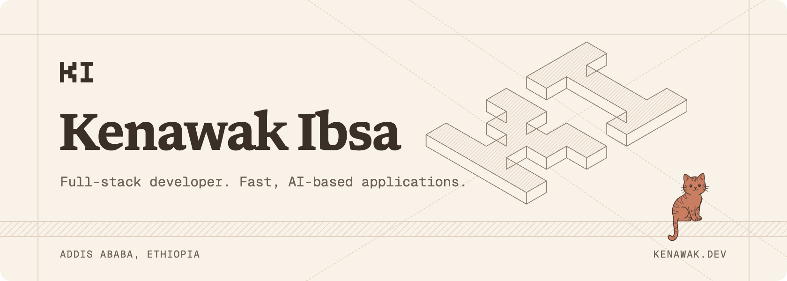

  <a href="https://kenawak.dev">
    <picture>
      <source media="(prefers-color-scheme: dark)" srcset="assets/banner-dark.png">
      
    </picture>
  </a>

I'm Kenawak Ibsa (call me Ken), a full-stack developer in Addis Ababa. I build fast, AI-based applications: agents, RAG systems, and the web apps around them. I work at [Jami](https://jami.bio) on the product creators use to get paid, and study Information Science at Addis Ababa University.

[kenawak.dev](https://kenawak.dev) · [X](https://x.com/keocodes) · [LinkedIn](https://www.linkedin.com/in/kenawak) · [Telegram](https://t.me/thekeocoder) · [Email](mailto:kenawakibsa95@gmail.com)

### Work

|      | Project | What it is |
| :--- | :--- | :--- |
| `01` | **[Solara Labs](https://solara-labs.com)** | A studio for AI products and custom software. Agents, web apps, voice, and the systems around them. |
| `02` | **[Suqe](https://suqe.bio)** | Turns a Telegram channel into a store. Buyers pay with Telebirr, CBE, or M-PESA, and the payment is checked with the bank instead of a screenshot. |
| `03` | **[Launchpot](https://launchpot.space)** | A launch board where fans back the makers they like. Ranked by support, not by an algorithm. |

### Stack

|      |      |
| :--- | :--- |
| **Language** | TypeScript, JavaScript, Python |
| **Frontend** | React, Next.js, Tailwind CSS, shadcn/ui, Radix UI, Base UI, Motion, TanStack, Expo, React Native |
| **Backend and data** | Node.js, Bun, FastAPI, PostgreSQL, MongoDB, Redis, Firebase, nginx |
| **AI** | LLM apps, RAG systems, AI agents |
| **Workflow** | Git, GitHub, Docker, Vercel, Linux, Claude, Cursor |
| **Design** | Figma, Paper, Photoshop |

### Focus

AI agents, RAG systems, and AI-powered web apps. Also interested in AI safety, agentic systems, and AI for low-resource languages.

### Activity

  <a href="https://github.com/kenawak">
    <picture>
      <source media="(prefers-color-scheme: dark)" srcset="assets/activity-dark.svg">
      
    </picture>
  </a>

Redrawn every day from live GitHub data by a small script in this repo.

  <b>Building for the next billion users, starting from Addis Ababa.</b> 
  Open to collabs on RAG, agentic systems, and AI-powered products. <a href="mailto:kenawakibsa95@gmail.com">Say selam.</a>

The cat is Wurroo.

